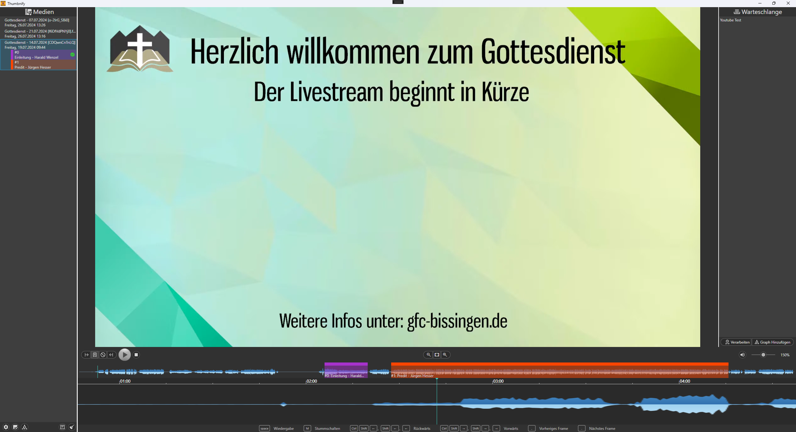
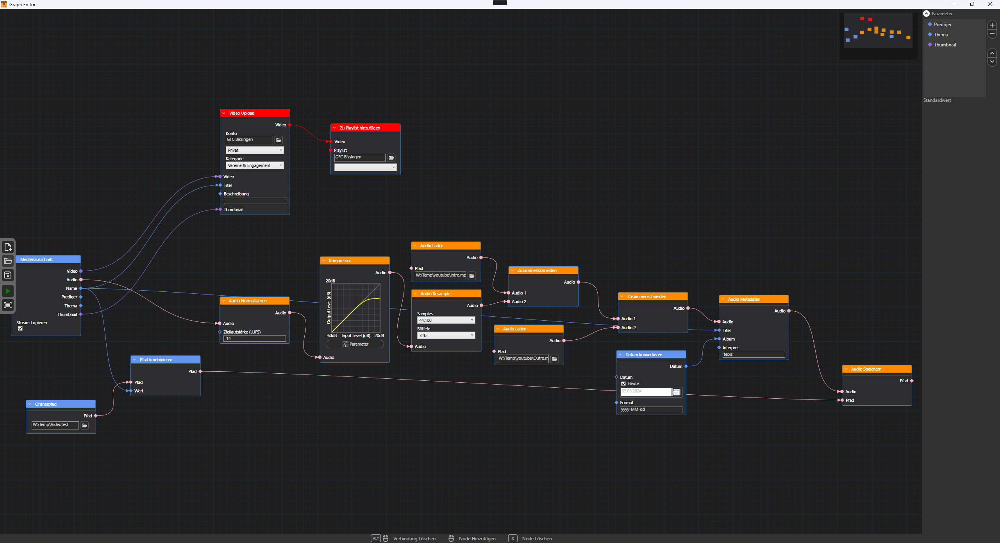
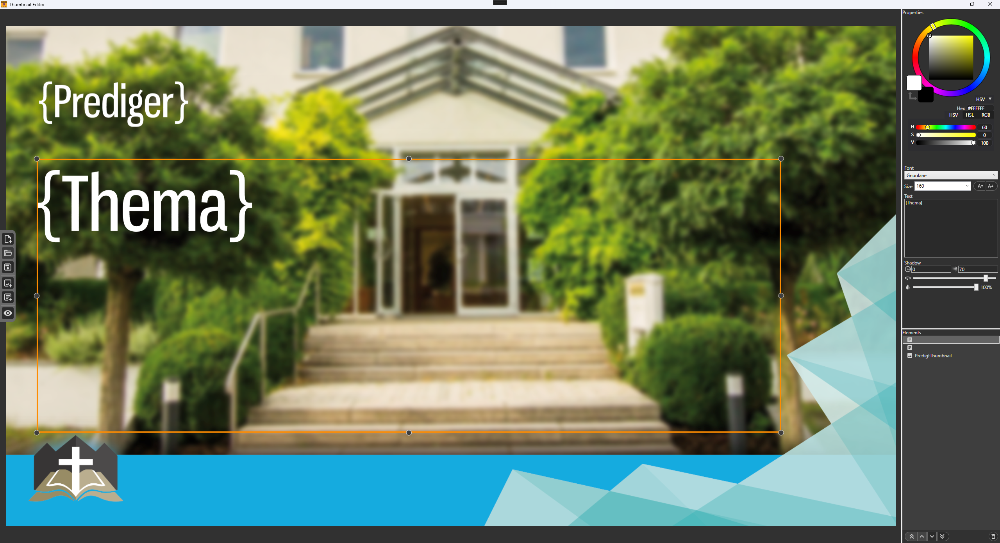

# Thumbnify

Thumbnify is a tool to easily execute repeated tasks on a recording or parts of a recording, like Uploading, extracting Audio, Normalizing etc.

It allows you to select parts of a recording and execute customized actions on those parts.

It can also generate Thumbnails for your Videos.

Thumbnail text supports horizontal and vertical alignment, bold, and italic styling.
These settings are saved with the preset. In the live preview and rendered output,
`{date}` inserts the current local date in `dd.MM.yyyy` format. Use
`{date|yyyy-MM-dd}` for a custom .NET date format. An explicitly defined graph
parameter named `date` takes precedence over the built-in date placeholder.

For a detailed How to use, head to the wiki.